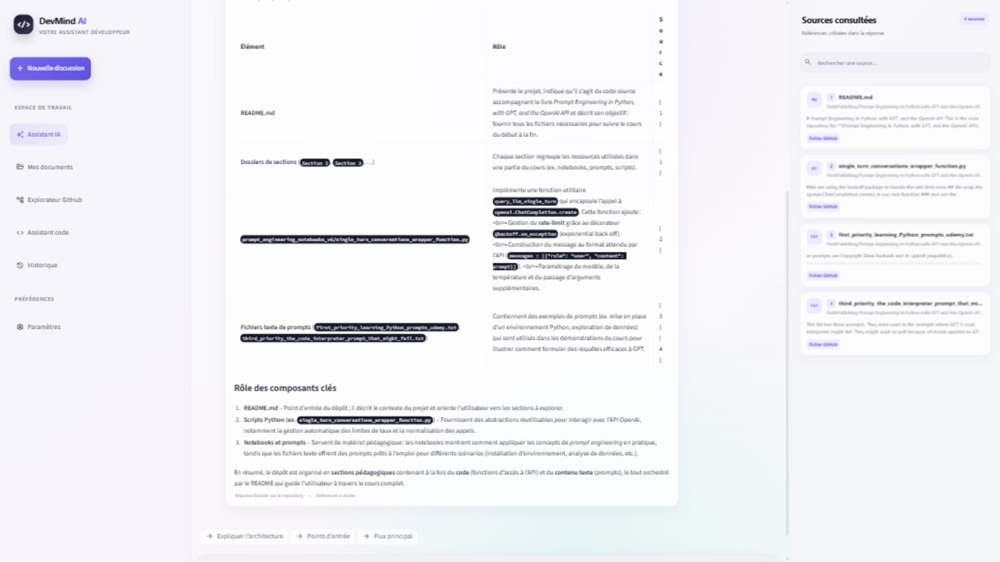
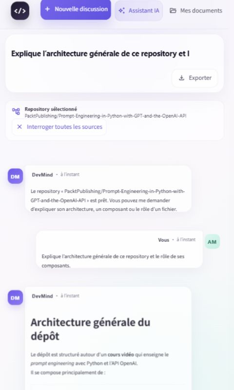

# DevMind AI

DevMind AI est un assistant pour développeurs construit avec Streamlit. Il peut
interroger des documents et des repositories GitHub publics avec un pipeline RAG,
ou analyser directement du code Python et JavaScript avec Groq.

## Fonctionnalités

- ajout de plusieurs documents PDF, TXT ou Markdown ;
- extraction du texte et conservation du nom de fichier et du numéro de page ;
- nettoyage et découpage en passages avec chevauchement ;
- embeddings multilingues calculés localement avec Sentence Transformers ;
- stockage temporaire des passages dans une collection ChromaDB isolée par session ;
- détection des documents identiques par empreinte SHA-256 ;
- recherche sémantique et réponses Groq contextualisées ;
- références réelles affichées dans le panneau « Sources consultées » ;
- panneau de sources contextuel, visible uniquement lorsqu'une réponse utilise
  effectivement des extraits ;
- questions limitées à un document depuis la bibliothèque ;
- import sélectif de repositories GitHub publics, avec exclusion des dépendances,
  fichiers binaires, contenus générés et fichiers volumineux ;
- questions ciblées sur un repository et références vers les fichiers GitHub ;
- compréhension des questions globales sur un dépôt (but, architecture,
  composants) avec priorité au README, à la documentation, aux manifests et aux
  points d’entrée, sans mélanger les repositories ;
- assistant code pour expliquer, diagnostiquer, corriger, améliorer et produire
  des exemples d'utilisation ;
- rendu Markdown natif et sûr pour les titres, listes, tableaux et blocs de code ;
- lecture fluide des longues conversations grâce au défilement du workspace
  central, sans zone de messages imbriquée ;
- historique ouvrable et supprimable pendant la session Streamlit ;
- gestion explicite des fichiers invalides, documents vides et erreurs API.

## Installation

Depuis PowerShell, à la racine du projet :

```powershell
python -m venv .venv
.\.venv\Scripts\Activate.ps1
python -m pip install -r requirements.txt
```

Le modèle d’embeddings est téléchargé automatiquement lors de la première visite
d’une page utilisant le RAG. Son chargement démarre après l’affichage de
l’interface, puis la même instance en lecture seule est réutilisée par toutes les
sessions du processus. Les documents et index, eux, ne sont jamais partagés.

## Configuration Groq

Copiez `.env.example` vers `.env`, puis ajoutez votre clé :

```powershell
Copy-Item .env.example .env
```

```dotenv
GROQ_API_KEY=votre_cle_api_groq
```

Le fichier `.env` est ignoré par Git. Ne placez jamais une clé réelle dans
`.env.example`, le code source ou une capture d’écran. Sur Streamlit Community
Cloud, configurez la même variable dans **App settings > Secrets**. Après
modification de la clé, relancez l’application afin de recréer le client Groq.

Le modèle utilisé est `openai/gpt-oss-120b`.

## Lancer l’application

```powershell
.\.venv\Scripts\Activate.ps1
streamlit run streamlit_app.py
```

L’application est accessible sur `http://localhost:8501`.

## Utilisation

1. Ouvrez **Mes documents**.
2. Sélectionnez un ou plusieurs fichiers PDF, TXT ou Markdown.
3. Cliquez sur **Analyser et ajouter**.
4. Cliquez sur **Poser une question** pour limiter la recherche à un document,
   ou ouvrez **Assistant IA** pour interroger toute la bibliothèque.
5. Consultez les extraits et pages utilisés dans le panneau de droite.

Pour explorer GitHub, ouvrez **Explorateur GitHub**, saisissez l'URL racine d'un
repository public, puis lancez son indexation. Les imports publics utilisent
l'API GitHub sans authentification et peuvent donc être limités par GitHub.
Un repository déjà indexé est réutilisé sans nouveau téléchargement.

L'**Assistant code** envoie uniquement le code collé, le message d'erreur et la
consigne à Groq. Il n'utilise pas les sources ChromaDB et l'interface le signale
explicitement.

Les documents, repositories, index ChromaDB et conversations appartiennent à la
session Streamlit courante. Ils ne sont ni visibles par une autre session ni
présentés comme un stockage permanent. Un redémarrage du serveur crée un nouvel
espace inaccessible aux anciennes sessions ; les anciens répertoires temporaires
sont supprimés après expiration.

## Aperçus





## Tests

```powershell
python -m pip install -r requirements-dev.txt
.\.venv\Scripts\python.exe -m pytest -q
```

Les tests unitaires injectent de petites doublures déterministes pour éviter tout
appel Groq. Les tests Streamlit exercent en plus les parcours d’upload et peuvent
charger le modèle local. Une campagne réelle, bornée à neuf appels Groq, est
disponible séparément :

```powershell
.\.venv\Scripts\python.exe scripts\run_real_validation.py
```

## Limites connues

- les PDF composés uniquement d’images ne sont pas lisibles sans OCR ;
- la première utilisation du RAG télécharge le modèle d’embeddings multilingue ;
- les conversations restent en mémoire de session Streamlit ;
- les données sont temporaires : fermer la session ou redémarrer l’application
  peut les rendre indisponibles ;
- cette démonstration publique n’offre ni compte utilisateur ni stockage durable ;
- les fichiers sont limités à 8 Mo, cinq fichiers par opération et 1 800 passages
  indexés par session ;
- les appels Groq sont limités par session et par processus afin de protéger la
  démonstration publique ;
- l'import GitHub est limité aux repositories publics, à 15 Mo d'archive,
  250 fichiers retenus, 5 Mo de texte brut et 400 000 caractères indexables ;
- les repositories exceptionnellement volumineux doivent être analysés par parties ;
- le premier chargement du modèle d’embeddings peut prendre environ une minute
  sur une machine CPU et consomme une part importante de la mémoire disponible ;
- l'assistant code nécessite une clé Groq valide et transmet le code collé au
  service d'IA.

Consultez [ARCHITECTURE.md](ARCHITECTURE.md) pour le détail du pipeline.

## Déploiement sur Streamlit Community Cloud

Le projet est préparé pour **Python 3.12**, avec `streamlit_app.py` comme point
d’entrée et des dépendances de production épinglées dans `requirements.txt`.

1. Publiez le contenu du projet dans un repository GitHub, sans `.env`,
   `.streamlit/secrets.toml`, `.devmind/`, environnement virtuel ni journaux.
2. Dans Streamlit Community Cloud, choisissez le repository, la branche `main`
   et le fichier `streamlit_app.py`.
3. Dans **Advanced settings**, sélectionnez Python 3.12 et ajoutez :

   ```toml
   GROQ_API_KEY = "votre_cle_groq"
   ```

4. Déployez, puis vérifiez l’upload d’un petit document, une question sourcée,
   l’import d’un repository public et l’assistant code.

Le guide complet, les commandes Git, le diagnostic des logs et la checklist de
validation sont détaillés dans [DEPLOYMENT.md](DEPLOYMENT.md).

